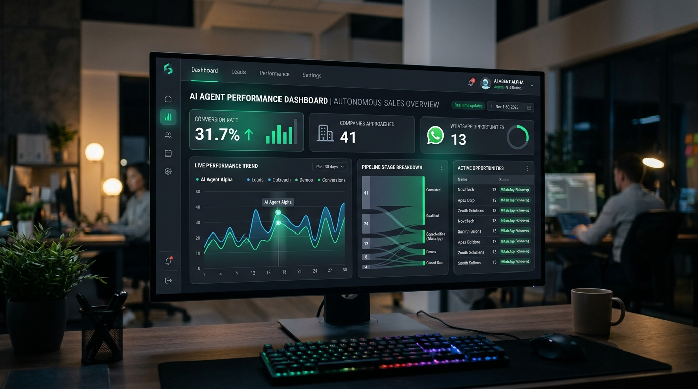
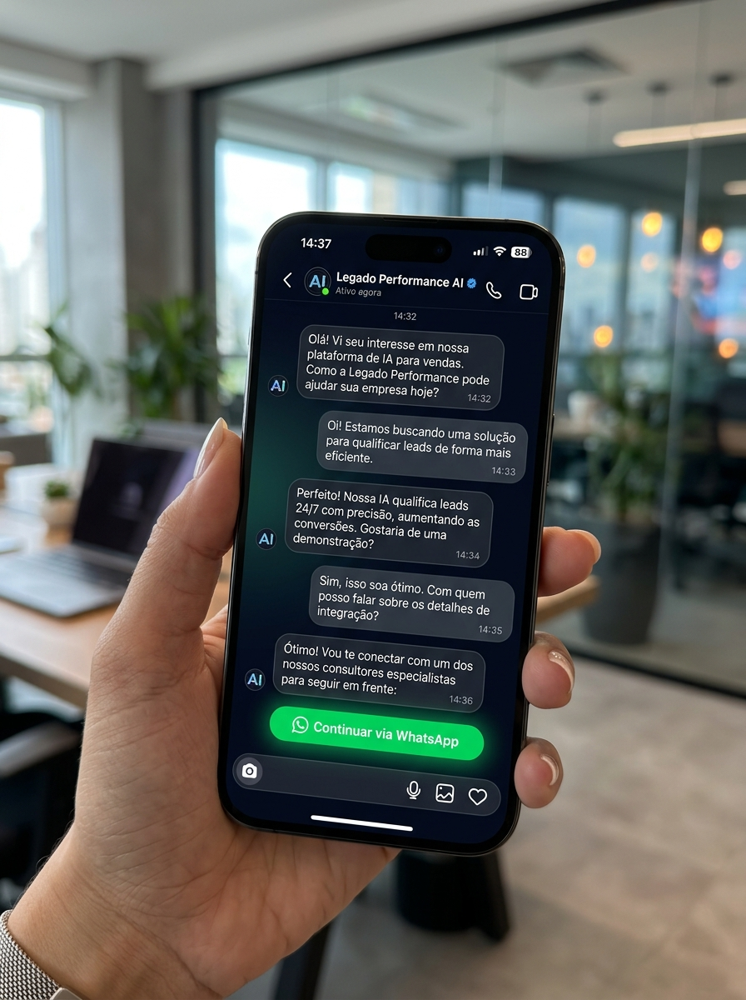

# Proposta: Máquina Comercial Legado

Para: Leo  
Prazo: 7 dias de implementação  

## Resumo Direto

Analisei o vídeo que você me mandou sobre o funil autônomo. A ideia central funciona muito bem, mas o papo de "copiar e colar código pronto" tem uma pegadinha técnica perigosa: disparar mensagens frias sem a API oficial gera bloqueio da conta no Instagram em poucos dias.

Para a Legado Performance, estruturei um modelo seguro, rápido de rodar e que gera receita em duas pontas.

## O Que a Máquina Faz

1. O lead entra pelo Direct do Instagram (via anúncio ou post).
2. A inteligência artificial responde em menos de 10 segundos.
3. Ela qualifica o contato: pergunta nicho, faturamento e verba para anúncios.
4. Curiosos são filtrados sem gastar tempo da equipe.
5. O lead pronto e com interesse real dispara automaticamente um webhook que entrega o contato direto no WhatsApp do seu SDR, com o resumo da conversa.

## Qual a Melhor Opção: Modelo A ou Modelo B?

A resposta é direta:

* Modelo A (Anúncios + IA no Direct): Risco zero de bloqueio. Usa a API oficial da Meta e aproveita a especialidade da Legado, que é tráfego pago. O lead já chega interessado.
* Modelo B (Disparo frio em massa): Alto risco de derrubar a conta principal. Só faria sentido no futuro usando perfis secundários descartáveis.

Para a conta oficial da Legado, o Modelo A é a única opção recomendada.

## As Duas Formas de Ganhar Dinheiro com Isso

1. Operação Interna (Legado Performance):  
Seu SDR para de perder tempo prospectando no braço e passa a receber reuniões pré-qualificadas no WhatsApp todos os dias.

2. Produto para Clientes (Máquina de Orçamentos):  
Usamos a Legado como vitrine e vendemos essa mesma automação para os clientes da sua assessoria por 3 a 5 mil reais cada. Quem paga a conta são eles, e dividimos o lucro da implementação.

## Simulação de Funil Sequencial (Exemplo Mensal)

* 1.200 contatos iniciados no Direct (via tráfego).
* 840 contatos concluem a triagem da IA (70% de engajamento).
* 294 leads aprovados no perfil de cliente ideal (35% dos triados) e enviados automaticamente via webhook para o WhatsApp do SDR.
* 74 reuniões confirmadas na agenda (25% de agendamento pelo SDR).

Toda a matemática segue uma esteira sequencial e sem perda de lógica.

## Cronograma de 7 Dias

* Dia 1: Alinhamento das perguntas de qualificação e regras de corte.
* Dia 2: Criação das respostas da IA e tratamento de objeções.
* Dia 3: Conexão oficial com o Instagram da Legado via API da Meta.
* Dia 4: Integração da IA com o WhatsApp do SDR.
* Dia 5: Bateria de testes simulando clientes reais.
* Dia 6: Piloto com tráfego real em volume controlado.
* Dia 7: Operação ativa 24 horas por dia e playbook pronto para venda.

## Custos de Ferramentas

O custo técnico mensal é baixo e pago direto às plataformas:

* OpenAI (inteligência das respostas): 40 a 100 reais por mês.
* ManyChat (canal oficial com a Meta): cerca de 85 reais por mês.
* Gateway de WhatsApp: zero a 80 reais por mês.  
Total: menos de 250 reais por mês.

O investimento para a implementação da Máquina Comercial Legado e o formato da nossa parceria na venda da Máquina de Orçamentos para os seus clientes serão alinhados diretamente em nossa conversa.

## Próximo Passo

Se aprovar o escopo, começo a montagem hoje mesmo para entregarmos tudo rodando na próxima semana.
